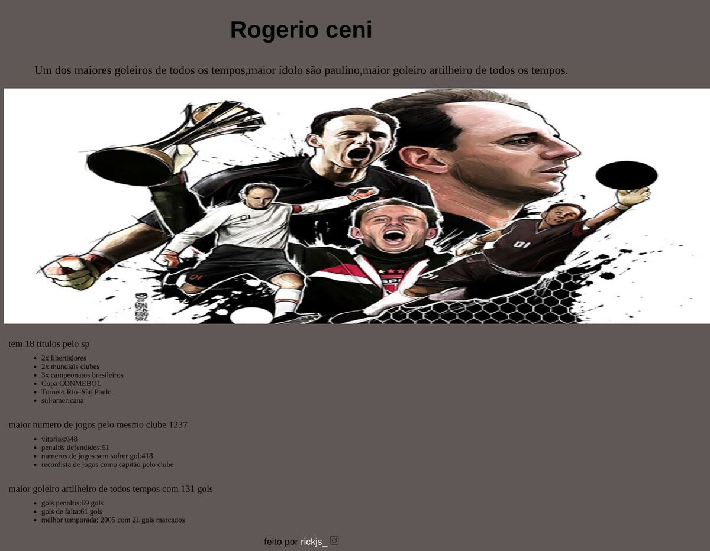

# tributo-page

[English](README.md)

Página tributo ao goleiro Rogério Ceni, feita em HTML e CSS como exercício, inspirada no projeto "Build a Tribute Page" do currículo Responsive Web Design do [freeCodeCamp](https://www.freecodecamp.org/learn/2022/responsive-web-design/). É uma homenagem de fã, sem vínculo com o atleta nem com o São Paulo FC.

> **Tipo:** projeto de estudo (2023)



## O que tem

- Título, frase de apresentação e uma ilustração em destaque.
- Listas com títulos pelo São Paulo, números de jogos e gols marcados.
- Rodapé com link para o Instagram do autor da página.

## Como abrir

Não há dependências nem build. Abra `index.html` no navegador ou sirva a pasta:

```bash
python3 -m http.server 8000   # depois acesse http://localhost:8000
```

## Estrutura

- `index.html`: conteúdo.
- `style.css`: estilos.
- `ceni21.jpg`: ilustração principal.
- `icone insta.png`: ícone do Instagram (o arquivo é WebP, apesar da extensão).

## Sobre os dados

Números conferidos em fontes jornalísticas em 2026: 1.237 jogos e 131 gols pelo São Paulo (61 de falta e 69 de pênalti), 51 pênaltis defendidos e 18 títulos oficiais pelo clube ([Gazeta Esportiva](https://www.gazetaesportiva.com/?p=3394588), [Lance!](https://www.lance.com.br/lancepedia/a-historia-de-rogerio-ceni-no-sao-paulo.html)). As vitórias (648), os jogos sem sofrer gol (418) e os 21 gols em 2005 vêm da versão original da página e não foram conferidos. A lista de títulos mostra só uma parte dos 18.

## Limitações

- Não implementa todos os requisitos do desafio do freeCodeCamp (por exemplo, os `id` exigidos).
- Sem responsividade: a imagem tem 1500 px de largura fixa e gera rolagem horizontal em telas menores.

## Créditos

- `ceni21.jpg` é uma ilustração de terceiros (há assinatura do artista na imagem); a origem não está documentada. Para reutilizar, obtenha autorização do artista ou troque por uma imagem licenciada.
- Origem do ícone do Instagram não documentada.

## Segurança

Veja [SECURITY.md](SECURITY.md).

## Licença

Ainda não há licença definida; todos os direitos reservados ao autor (isso não cobre a ilustração de terceiros).
